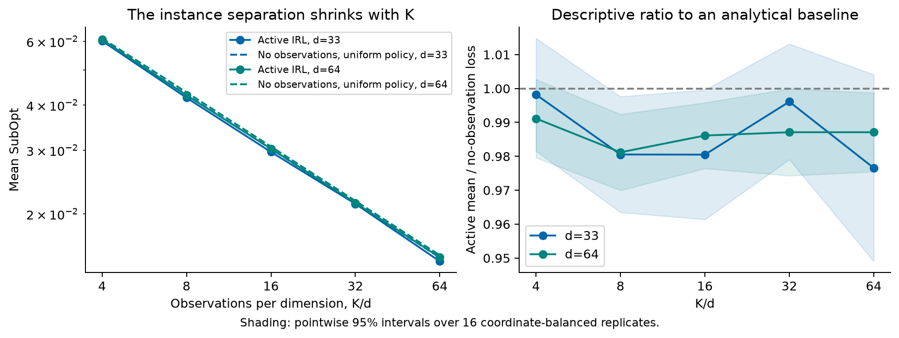

# Scientific validation

Active clearly improves on the unregularized fixed-expert protocol in this game.
Tuning the expert closes much of that gap, and the separate fresh superiority
test is inconclusive. An additional warm-up benefit is also not established.

The prospective confirmation follows [the frozen protocol](PROTOCOL.md), committed
as `622e5ca` before confirmation training. All pre-existing paper data are retained.
The first confirmation keeps the retained Active settings fixed. A separate
[amendment](AMENDMENT-tuned-baseline.md) selects a fixed-expert ridge on that data
and tests it on another fresh split; it does not turn the first split into an
independent test of the selected ridge.

New trajectories and task evaluations live in
`artifacts/scientific-validation-20260919/`; compact endpoints and audit records
are preserved beside this report.

## Fresh fixed-settings confirmation

After the numerical repair, both retained Active protocols have lower mean loss
than matched-ridge-zero fixed-expert MLE on the 100-task primary suite. The table
uses 50 fresh learning seeds and 1,600 follower observations per protocol.
Values and intervals are multiplied by 1,000.

| Protocol | Mean transfer SubOpt | Pointwise 95% interval |
| --- | ---: | ---: |
| Active, no warm-up, multiplier .03 | .286 | [.208, .363] |
| Active, warm-up 200, multiplier .003 | .261 | [.172, .350] |
| Fixed-expert MLE, ridge zero | 3.488 | [2.570, 4.406] |

The paired Active-minus-expert effects are -3.202 (simultaneous 95% interval
[-4.272, -2.133]) and -3.227 ([-4.277, -2.177]), in the same units. Both
Holm-adjusted p-values are approximately 8.98e-9. The intervals control the two
primary comparisons together; they are conditional on this task suite.
Paired bootstrap intervals also exclude zero. These results support a finite-budget
advantage over this unregularized expert protocol in the simulated game.

**They do not establish that warm-up helps once the information regularizer is
matched.** The warm-minus-no-warm effects are -.034 with 95% interval
[-.158, .089] at multiplier .003, and -.017 with interval [-.137, .103] at
multiplier .03. These secondary intervals are unadjusted and inconclusive;
important benefits or harms are not ruled out.

**Regularization substantially improves the expert baseline.** On the same data,
expert ridge values .01, .1, 1, and 10 give repaired mean losses of 3.412, 2.635,
.502, and .400 in the table's units. This grid was added after the first
confirmation began and is exploratory. Ridge 10 had the lowest mean among the
tested values; its choice was committed as `0c8ee89` before opening the separately
collected confirmation outcomes. It is not claimed to be a globally optimal ridge.

## Independent selected-baseline confirmation

On the separate 50-seed, 50-task suite, mean transfer losses were .251 for
no-warm Active, .205 for warm Active, and .347 for ridge-10 fixed-expert MLE
(all multiplied by 1,000). Neither superiority comparison passes the frozen
multiplicity-adjusted criterion:

| Active minus selected expert | Paired effect × 1,000 | Simultaneous 95% interval × 1,000 | Holm-adjusted p |
| --- | ---: | ---: | ---: |
| No warm-up, multiplier .03 | -.096 | [-.262, .069] | .185 |
| Warm-up 200, multiplier .003 | -.142 | [-.286, .003] | .055 |

The warm comparison has an unadjusted p-value of .0276 and a percentile-bootstrap
interval below zero. Neither replaces the frozen multiplicity-adjusted rule.
The result is inconclusive, not a demonstration of superiority, equivalence,
or absence of an effect. The sample remains fixed at 50 seeds; no extra runs
were added in response to these p-values. Confidence statements are adjusted
within each confirmation's two-comparison family, not jointly across every
exploratory contrast in this report.

**Recommended empirical claim:** Active policy selection learns a reward that
achieves low transfer loss without expert demonstrations in this simulated game.
It substantially outperforms the tested unregularized fixed-expert protocol;
strong ridge regularization closes much of that gap. The independent check does
not establish superiority over the selected regularized expert. Matched-factor
comparisons do not establish an additional warm-up benefit.

The theoretical result should be stated separately, with its actual assumptions
and parameter dependence.

Figures: [first-confirmation means](fresh-confirmation-methods.pdf),
[paired effects and warm-up contrasts](fresh-confirmation-contrasts.pdf), and
[independent selected-baseline check](independent-tuned-baseline.pdf).

## Which evidence is independent?

| Stage | Learning seeds | Task seed | Role |
| --- | --- | --- | --- |
| Earlier selection | 94000–94007 | 9400 | Selected retained Active settings; later reused for the displayed ridge-zero grid |
| Earlier confirmation | 95000–95019 | 9500 | Later reused for the ridge-zero replay |
| Retained paper evaluation | 30000–30049 | 9200 | Learning seeds had appeared in development |
| First new confirmation | 2026092000–2026092049 | 202609200 | Fresh test of the retained Active settings against ridge-zero controls; subsequently used to select the exploratory expert ridge |
| Selected-ridge confirmation | 2026093000–2026093049 | 202609300 | Separate fresh test against that selected baseline |

Two secondary task suites (202609201 and 202609202) reuse the first confirmation's
learning seeds. They assess sensitivity to target objectives, not independent
replication of learning. All tasks remain within the same game.

## Findings from the retained evidence

**The strongest empirical question is transfer at a fixed observation budget.**
The Lobeke study compares complete observation-and-estimation protocols in one
GUARD-derived game, with a correctly specified simulated follower. It does not
establish superiority across environments, unknown inverse temperatures, or
misspecified response models. Signed synthetic target priorities are diagnostic
objectives, not observed conservation priorities.

**The old sensitivity plot is not the original selection grid.** The retained
settings came from an eight-seed, 100-task selection stage with MLE ridge 1e-4.
The displayed grid later reran that split with ridge zero. Its correct dimensions
are 1,600 observations, eight learning seeds, and 100 tasks, not the sample counts
in the supplied PDF. Outlined cells mark the retained settings, not empirical
minima of the later grid. The 20-seed confirmation replay also reuses an earlier
split; the 50-seed final evaluation reuses development seeds. Changing estimator
or evaluation settings does not turn those seeds into an untouched holdout.

**Warm-up and regularization must be separated.** Comparing warm-up/.003 against
no-warm-up/.03 compares protocols, not warm-up alone. Historical matched contrasts
were inconclusive. The fresh confirmation crosses both factors. Neither a
non-significant difference nor a lowest grid mean establishes equivalence or a
unique optimum. A 200-observation practical warm-up is not evidence that the
theorem's burn-in certificate has been satisfied.
The displayed theorem also uses online information regularizer zero, whereas
these practical variants use positive regularization. They do not directly test
the exact sufficient conditions of that theorem.

**The fixed Stackelberg expert is identifiable in this game.** Its per-observation
Fisher eigenvalues at the truth are approximately 7.89e-5, .0321, and .186, giving
condition number 2,357. It is poorly conditioned, not rank deficient. Thus the
Lobeke comparison can support a finite-budget advantage from informative sampling;
it does not demonstrate the worst-case impossibility lemma for fixed experts.
At 1,600 observations, the retained Active protocols yield mean minimum
cumulative Fisher eigenvalues around 13.6 versus .126 for fixed-expert sampling.
At 200 observations, the tuned no-warm-up protocols already reach approximately
1.51–1.56 versus 1.42 for the warm-up design. These diagnostics support informative
online selection, but not improved early conditioning from warm-up relative to
the retuned no-warm-up variants.
In the first confirmation, ridge 10 reduces the fixed expert's standard
deviation in its weakest Fisher direction from 1.365 to .036, but shifts the mean
coefficient from -.234 to -.008 when the true projection is -.436. The retained
Active means are -.428 and -.396. These descriptive diagnostics illustrate the
bias–variance tradeoff; the independent test assesses its downstream consequence.
The joint-QRE follower-only design is much more ill-conditioned (about 3.63e8).
Poor OLS performance on this instance should not be generalized to OLS in other
games. These are simulation diagnostics, not information available to the learner.

**The baseline information contract needs to remain explicit.** Fixed-expert MLE
samples a source Stackelberg expert. OLS uses a different joint-QRE expert;
zero-sum OLS also observes leader actions. The estimators do not negate the
evaluator's source reward to recover the follower reward. If a learner were
given both the exact unnormalized source reward and the exact zero-sum relation,
the follower reward would already be known. Claims concern the implemented
protocols, not all algorithms exploiting every possible piece of side information.

**The sparse-game explanation needed two corrections.** A mixed policy with mass
$x$ on the informative action has information $\eta^2x^2p(1-p)$, with
$p=\sigma(\eta\omega x)$. It has zero information only at $x=0$; random mixed
policies are usually weakly informative. Also, online information maximization
does not always select the pure informative action: 17.052% of the 100,000 saved
Active policies were interior. At estimate 2 and inverse temperature 2, the
information-maximizing mass is approximately .59984. The exact initial
active/random expected-information ratio is $m(m+1)/2$ at estimate zero.

**The hard-family slope is not a learning-rate validation.** Its separation is
$\epsilon=\tfrac12\sqrt{d/K}$, changing the instance as the budget changes. A uniform
policy that observes no data has loss $\sigma(\epsilon)-\sigma(\epsilon/d)$ and
already scales as $K^{-1/2}$. Across the ten retained grid cells, the Active mean
is 97.66–99.82% of this analytical no-learning loss. The additional figure shows
both curves and pointwise intervals over 16 coordinate-balanced replicates.
This does not invalidate the theorem; it limits what the empirical slope shows.



**The theorem comparison should claim only the matching dependence actually shown.**
The displayed expected-risk lower bound and high-probability upper bound share
inverse-square-root dependence on the online horizon. The upper bound includes
additional dimension, temperature, norm, and confidence factors. The displayed
lower bound does not establish confidence-optimal dependence on delta. This is
a claim-level comparison, not a complete verification of all proofs.

## Numerical validity

The initial fast evaluation is preserved in `results.json` and `endpoints-*.npz`.
The expanded 550-deployment check found a genuine local-planner miss: one
fixed-expert loss changed from .04723 to .001504. The numerical repair uses the
full scalar planner with 64 random starts, all 23 pure policies, the uniform
policy, and tolerance 1e-12. Corrected endpoints are saved separately. This
post-result repair and its timing pilot are recorded in
[the numerical amendment](AMENDMENT-numerical-evaluation.md).
All methods share one numerical oracle value per task. Error in that common
reference cancels in paired loss differences and in the ridge-selection ranking.
Uncertainty about each fitted model's deployed policy does not cancel; that is
the issue addressed by the full multistart repair. Absolute SubOpt values still
use a numerical reference rather than a certified global optimum.

A separate check of 80 training-policy decisions found two gains improved by
full multistart search: 11.39% and .441% relative to the original gain, both
immediately after warm-up. The remaining checks agreed to numerical precision.
These are approximate policy-selection implementations; a small stationarity
residual is not a certificate of a global maximizer. No training trajectory was
changed in response to this check.

Stricter MLE refits changed the checked coefficients by at most 1.96e-7. All
550 first-confirmation jobs passed shape, finiteness, probability-simplex, and
parameter-ball checks. All 46 protected pre-existing data files retained their
original hashes.

The zero-estimate deployment rule, which receives no follower observations, has
mean loss .01299 on the first primary suite (.01387 and .01453 on the secondary
suites). This is a simple no-learning reference, not a lower bound on all possible
prior-informed methods.

The retained paper's final-checkpoint audit covered all 4,500 deployments. Its
largest individual loss change was 5.49e-6; the largest change in a method mean
was 9.30e-8. The separate full-curve audit reuses these endpoints and checks the
remaining 43,500 plotted deployments. It found five changes above 1e-4: four
fixed-expert deployments and one online-random deployment. The largest individual
loss change was .05244; the largest change in a plotted method mean was .00010496.
Active curve means changed by less than 4.60e-8. All five materially changed
cases were stable under an additional 256-start check: fitted objectives changed
by at most 1.67e-16 and deployed values by at most 4.11e-11. These repaired SubOpt curves are
saved in `historical-strict-curves.npz`, alongside the preserved originals.
This is a SubOpt audit of the ten-task transfer curves, not a full re-evaluation
of the 180-task heatmap or every historical Fisher-error diagnostic.

The final 256-start stress check covered 62 deployments, including the ten
largest primary fast-to-strict changes and fixed early cases from all four task
suites. Compared with 64 starts, fitted objectives changed by at most 8.11e-15,
oracle values by 3.34e-16, and deployed values by 1.15e-9. This supports numerical
stability of the repaired measurements without asserting a global certificate.

The secondary suites retain the same qualitative ridge-zero comparison: means
(no-warm Active, warm Active, fixed expert) are (.291, .276, 3.398) and
(.326, .303, 3.704), multiplied by 1,000. They reuse the first confirmation's
learning seeds and are descriptive sensitivity checks.

## Manuscript changes

[Replacement LaTeX passages](manuscript-corrections.tex) cover the supplied PDF's
tuning caption, sparse-game setup, feature/temperature normalization, hard-family
interpretation, and upper/lower-bound comparison. The original PDF is unchanged.
The repository's preview text has been corrected separately; no retained figure
data or generated figure has been replaced.

The normalization is $\phi=\phi_{\rm raw}/L$ and
$\eta=L\eta_{\rm raw}$, with raw inverse temperature 1.25 and numerical inverse
temperature approximately 2.165. Scaling only the features would describe a
different response distribution.
The retained information multipliers .003 and .03 therefore correspond to
absolute online regularizers .0140625 and .140625; neither is an MLE penalty.

## Reproduce the additional evidence

From the repository root, recompute the statistics and additional plots from
the compact data, without GUARD or training:

```sh
uv sync --locked --extra experiments
export PYTHONPATH=.
uv run python archive/scientific-validation-20260919/analyze_strict.py
uv run python archive/scientific-validation-20260919/tuned_baseline_analysis.py analyze
uv run python archive/scientific-validation-20260919/plot_results.py
uv run python archive/scientific-validation-20260919/replay_strict.py
```

The last command repeats a small set of full-multistart deployments. The compact
model packs include features, true simulation coefficients, learned estimates,
and exact task matrices; they do not require the original GUARD application.

To repeat all numerical evaluations, use `strict_evaluation.py run` with a new
`--output-dir`. Its default compact pack contains the first confirmation;
`--data archive/scientific-validation-20260919/tuned-baseline-compact-data.npz`
selects the independent baseline check. Full replay is substantially slower
than recomputing statistics. The protocol amendments record measured costs.

Full training additionally requires GUARD. `validate.py train` runs the first
confirmation; `tuned_baseline.py train` runs the selected-baseline observation
protocols. Their outputs use separate ten-seed batches and resume completed
protocol files. Preserve the frozen selection before running
`tuned_baseline_analysis.py pack`. The original fast measurements and strict
repairs remain separate.

| Material | Files |
| --- | --- |
| Frozen designs and subsequent amendments | `PROTOCOL.md`, `AMENDMENT-*.md` |
| Initial measurements | `results.json`, `endpoints-*.npz` |
| Repaired first confirmation | `strict-results.json`, `strict-endpoints-*.npz` |
| Independent selected-baseline test | `tuned-baseline-selection.json`, `tuned-baseline-results.json`, `tuned-baseline-endpoints.npz` |
| Self-contained model inputs | `compact-data.npz`, `tuned-baseline-compact-data.npz` |
| Numerical and provenance checks | `*-numerics.json`, `quality-checks.json`, `execution-*.json` |
| Preserved raw trajectories and intermediate evaluations | `raw/`, mirroring `artifacts/scientific-validation-20260919/` |
| Suggested paper wording | `manuscript-corrections.tex` |

`new-artifact-sha256.json` checksums the local outputs; `existing-data-sha256.json`
protects the pre-existing paper inputs. The archive manifest checksums the
private-repository copies. The original manuscript PDF is unchanged.

## Measured cost and checks

| Stage | Scope | Elapsed time |
| --- | --- | ---: |
| First confirmation training | 550 jobs, 1,600 observations each | 35.1 min |
| Full multistart repair | 90,000 deployments, four workers | 80.0 min |
| Independent baseline training | 150 jobs, 1,600 observations each | 22.5 min |
| Independent baseline evaluation | 7,500 deployments, four workers | 7.2 min |
| Retained final-checkpoint audit | 4,500 deployments, two workers | 7.0 min |
| Remaining retained curves | 43,500 deployments, four workers | 40.6 min |

Some jobs ran concurrently on this 12-logical-CPU machine. These are measured
local costs, not speed claims for the algorithm. No additional training was
started after the independent statistical result. The 206 functional tests,
static checks, and ten original figure checks passed. The original 46 protected
data files retained their hashes.

A separate clone of commit `c5c968d`, with a new environment and no GUARD
checkout, reproduced all 21 checked result/data/figure artifacts byte-for-byte.
It also reproduced 72 strict deployment checks exactly and passed all ten
original figure checks. This verifies reconstruction from the committed data
on this machine; it is not a claim of bitwise portability across platforms.

## Remaining limits

This work does not certify global nonconvex optimization or audit every theoretical
proof. The displayed bounds support matching horizon dependence, with other
factors left explicit. GUARD redistribution permission remains unresolved in
`THIRD_PARTY.md`; numerical verification does not resolve that publication issue.
